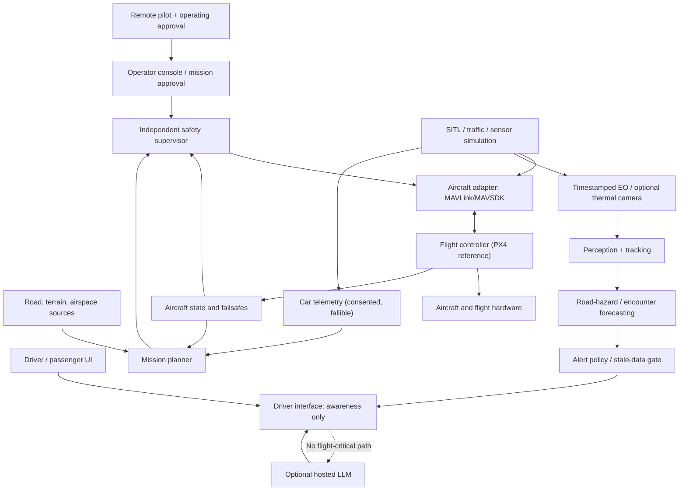

# 02 — Logical architecture and deployment boundaries (v0.1 DRAFT)

## Context and trust boundary

## Separation of control and information
**Flight-control plane**: RC/RPIC, onboard autopilot, state estimator, actuator commands, preconfigured failsafes. Must remain viable during loss of companion computer, AI service, or car connectivity.

**Safety authorization plane**: deterministic mission/airspace/energy/obstacle constraints. Can veto or cancel planner requests. May request only high-level actions through documented flight-controller modes; cannot weaken flight controller failsafes.

**Intelligence plane**: geospatial visibility, object detection/tracking, risk description, encounter forecasts, alerts. Its findings are **never directly converted into low-level motor commands** and do not constitute passing permission.

**Conversation plane**: optional OpenAI-based explanations and mission inquiries. Cannot arm, disable geofence/failsafe, suppress hazard, or issue flight-control setpoints.

## Planned logical modules
| Module | Responsibility | Inputs | Outputs |
|---|---|---|---|
| mission-core | State machine; mission lifecycle and provenance | operator consent, plans, aircraft health | state transitions |
| geo-intel | Road graph, elevation, airspace, visibility & map freshness | licensed/static data, camera calibration | candidate observable road segments |
| route-optimizer | Safe candidate air paths, energy / coverage tradeoffs | geo output, vehicle predictions, aircraft envelope | proposed mission |
| aircraft-adapter | Telemetry translation, capability discovery, high-level commands | MAVLink / simulator | normalized aircraft state and acknowledgments |
| safety-supervisor | Policy admission, geofences, stale-data cutoffs, overrides | plan, mission mode, approval, health | allow / deny / abort with reason |
| sensor-ingest | Synchronization and calibration | video, thermal, IMU/GNSS | timestamped sensor frames |
| perception | Detections, classification and location uncertainty | synchronized frames | object observations |
| multi-target-tracker | Probabilistic trajectories, identity association and track expiry | observations, ego-motion | tracks and covariance |
| traffic-forecast | Catch-up intervals, motion possibilities, road hazards | tracks, road context | hazard events and forecast intervals |
| alert-engine | Non-distracting prioritized announcements | hazard events and confidence | alerts, suppression reasons |
| operator-console | RPIC status, authorizations, abort and evidence | state, alerts, policy | approved operator intents |
| driver-client | Read-only situational awareness | alerts | low-distraction messages |
| copilot | Explanatory dialog only | sanitized, approved summaries | natural language |
| observability | Replay, diagnostics, signed configs, event trace | all component metadata | redacted evidence |
| simulation | Digital scenario ground truth + injected faults | scenario manifests | simulated sensors/car/flight |

## Deployment hypothesis
- **Aircraft:** independent autopilot + on-board safety mechanisms, sensors, and companion compute for latency-sensitive perception if power/mass permits. Aircraft shall not require cloud calls for stabilization or termination response.
- **Ground station:** mission planning, local replay/analysis, operator supervision, non-critical compute.
- **Car:** driver-facing read-only alert client. Any routing/position input is explicitly consented and untrusted.
- **Cloud:** optional model explanations and offline analytics, never a safety or continuous-operation dependency.
- **Simulator:** can replace aircraft/vehicle/sensor sources using the exact same component boundaries.

## Critical command flow
1. Operator selects an eligible, authorized scenario/site and mission goals.
2. Planner proposes a route and expected coverage with explicit unknowns.
3. Safety supervisor validates route, airspace, energy reserve, operator approval and status.
4. Adapter sends supported high-level mission/mode changes and checks ACK/vehicle state.
5. Controller executes the plan; operator has override.
6. Any violation transitions to a conservative, preplanned contingency appropriate to the aircraft/site.

## Notes
Do not blindly use PX4 Offboard setpoint streaming for long-range mission control: it requires sustained external liveness and has defined offboard-loss behaviors. Prefer robust flight-controller mission execution for baseline, with carefully scoped companion-computer high-level updates. Compare PX4 and ArduPilot mission upload semantics before relying on updates. Sources: https://docs.px4.io/main/en/flight_modes/offboard and https://mavlink.io/en/services/mission.html
