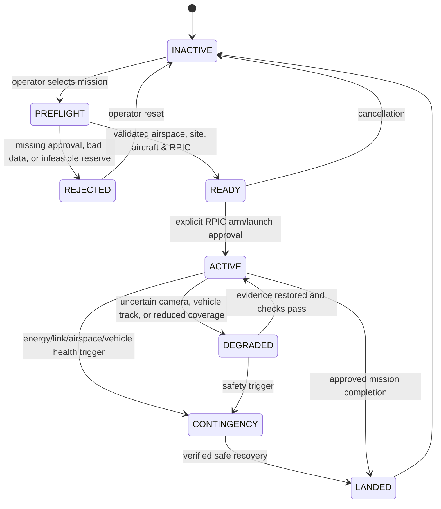

# 06 — Safety case, flight authority and regulatory envelope (v0.1 DRAFT)

**Architecture is not flight approval.** Regulatory feasibility for a moving-car aerial escort is unresolved. The operational envelope must be derived with qualified aviation/legal review, local airspace research, aviation authority authorizations, responsible RPIC, and site-specific hazard analysis. Software must reject ineligible operations rather than invent exceptions.

## Regulatory baseline (United States)
- The FAA's current Part 107 overview: https://www.faa.gov/newsroom/small-unmanned-aircraft-systems-uas-regulations-part-107
- Waiver categories and limitations: https://www.faa.gov/uas/commercial_operators/part_107_waivers
- Visual line of sight: 14 CFR §107.31; video-link visibility is not an automatic substitute.
- Operation from moving vehicles: §107.25 (separate from whether the aircraft launched while stationary).
- Flight over people / moving vehicles: §§107.39, 107.110–107.145. Operation **near** roads and sustained flight **over** traffic have different hazards and rules. Specific exceptions/categories are conditional.
- General operating limitations: §107.51 (e.g., altitude, speed, visibility) absent applicable provisions/authorizations.
- Registration, Remote ID, controlled airspace permissions, pilot credential, night operation and state/local launch/land restrictions must be assessed by mission.
- Whether the intended use qualifies as recreational must be separately determined; **never assume recreational status bypasses VLOS or overflight restrictions**.
- An ordinary moving-car driver is not assigned RPIC responsibilities. A separate trained crew and visual observers may be required, and having observers alone is not blanket BVLOS authorization.

No service may be activated for actual flight purely from a checkbox saying “legal.” Document applicable authority, time/location, airframe characteristics, crew role and permission evidence.

## Core safety invariants
**INV-01** No actionable overtaking command or “clear to pass” indication.
**INV-02** No mission launch, arm or replanning execution without independent operator authorization and validated legal operating envelope.
**INV-03** No requested trajectory crosses forbidden geofence, hard terrain clearance or airframe envelope.
**INV-04** No continuation when projected reachable-safe-site energy is insufficient with uncertainty allowance.
**INV-05** Cloud/LLM unavailability cannot degrade flight-critical safety or manufacture confidence.
**INV-06** Stale/occluded camera or map evidence never turns unknown into safe.
**INV-07** RPIC override and onboard autopilot failsafes always take precedence.
**INV-08** Lost car position or route invalidates *escort* coverage assertions even if flight itself is stable.
**INV-09** Do not knowingly plan sustained overflight of moving vehicles where not legally authorized.
**INV-10** Operator, planner, and companion computer are unable to disarm safety interlocks in flight.

## Draft mission state machine

**Emergency authority** is held by the aircraft flight controller and RPIC; this conceptual software state machine cannot supersede either.

## Initial hazard register / mitigation strategy
| Hazard ID | Example | Architectural response | Validation |
|---|---|---|---|
| H-01 | Ground impact over people/vehicles | Exclude unsafe corridors, site-specific flight envelope, independent autopilot | pedestrian-area geofence |
| H-02 | Aircraft collides with manned aircraft | RPIC/VLOS, altitude/airspace limits, avoidance procedure | intruder scenario in simulator |
| H-03 | Mountain ridge blocks drone or camera | terrain raycasts, explicit unknown visibility, lost-link procedure | occlusion tests |
| H-04 | Drone loses GNSS / position integrity | independent position integrity checks, abort to aircraft-defined failsafe | corrupted GNSS injection |
| H-05 | Telemetry link interruption | onboard flight plan/failsafe independent of client | link-loss scenarios |
| H-06 | Video link interruption | driver client retracts observations; flight safety separately evaluated | blackout test |
| H-07 | Battery reserve misestimated / headwind | bounded energy plus reachable safe recovery | energy-model error sweep |
| H-08 | Software commands illegal flight | separate safety supervisor, signed mission envelope, operator permission | rejected-plan property tests |
| H-09 | False negative for oncoming car | confidence-aware alerts; no pass permission | missed-detection scenarios |
| H-10 | False positive causes dangerous driver response | minimal non-directive alerts, human-factors testing | distraction evaluation |
| H-11 | ML or LLM command injection | strict typed/signed control authority; LLM read-only | prompt-injection test |
| H-12 | Airspace/road data stale | expiry, authoritative verification, fail closed | stale-source fixtures |
| H-13 | VTOL transition or stall failure | measured envelope, autopilot failsafe, no unsupported maneuvers | SITL/HITL transition tests |
| H-14 | Recovery site becomes occupied | alternate preapproved safe sites and contingency reserves | denied-site simulation |
| H-15 | Remote pilot distraction from driving | separate RPIC and supervision policy | operating procedure review |
| H-16 | Car detours beyond safe drone corridor | disable escort coverage claim and contingency plan | route divergence injection |

## Decision precedence
Physical aircraft stabilization and configured autopilot failsafe > RPIC takeover > independently enforced mission safety constraints > planner request. A planner can request a safe route; it never commands the aircraft to ignore low-level flight protections.

## Risk process
Maintain severity/likelihood estimates separately from mitigations, track residual risk and evidence, and require a flight safety review before real-world use. Unresolved H-01/02/03/07/09 and legal feasibility are **hard blockers** for field operation.
